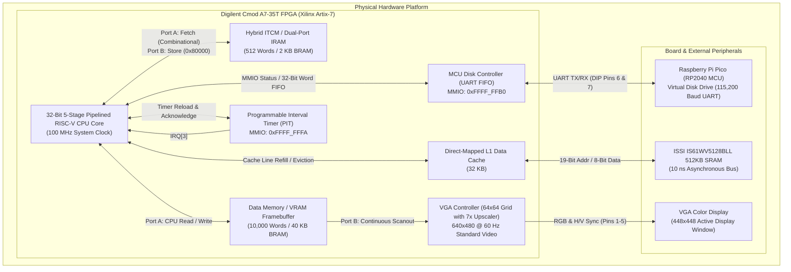

# CPU-RTOS Master System Architecture & Technical Manual

> [!NOTE]
> **Complete Technical Specification**  
> This document provides an exhaustive, unified architectural reference for the entire **CPU-RTOS** computing stack—from the silicon RTL on the Xilinx Artix-7 FPGA to the memory hierarchy, MMIO peripheral buses, RP2040 storage subsystem, 2-stage OS bootloader, C- compiler toolchain, and application runtime.

---

# Table of Contents
1. [Executive Architecture Overview](#1-executive-architecture-overview)
2. [Master System Memory Map](#2-master-system-memory-map)
3. [CPU Core Microarchitecture](#3-cpu-core-microarchitecture)
4. [Instruction Set Architecture (ISA) Specification](#4-instruction-set-architecture-isa-specification)
5. [Memory Subsystem, ITCM & Cache](#5-memory-subsystem-itcm--cache)
6. [Memory-Mapped I/O (MMIO) Peripherals](#6-memory-mapped-io-mmio-peripherals)
7. [Virtual Storage Subsystem & RP2040 Firmware](#7-virtual-storage-subsystem--rp2040-firmware)
8. [Two-Stage OS Bootloader & Interrupt Routing](#8-two-stage-os-bootloader--interrupt-routing)
9. [Software Toolchain, Compiler & Runtime](#9-software-toolchain-compiler--runtime)
10. [Hardware Pinout, Physical Wiring & Verification](#10-hardware-pinout-physical-wiring--verification)

---

# 1. Executive Architecture Overview

The **CPU-RTOS** platform is a complete, self-contained custom computer built from scratch across hardware, firmware, and software layers. 



### System Attributes
* **Primary Compute Unit:** Custom 32-bit pipelined RISC-V processor running at **100 MHz** on a Digilent Cmod A7-35T FPGA.
* **Execution Memory (ITCM):** 512-word dual-port Instruction Tightly-Coupled Memory allowing zero-wait-state combinational instruction fetch simultaneously with dynamic MMIO writes.
* **Auxiliary Storage Subsystem:** Raspberry Pi Pico (RP2040) acting as a virtual floppy/hard disk drive communicating over a full-duplex UART channel at 115,200 baud.
* **Display Engine:** Hardware VGA controller outputting standard 640×480 @ 60 Hz with a hardware 7× pixel upscaler mapping a 64×64 monochrome bitmap into a centered 448×448 viewport.
* **OS Boot Architecture:** True 2-stage multi-sector boot flow: Stage-1 hardware ROM fetches Sector 0 (Stage-2 OS loader), which commands the virtual disk across multiple sectors into upper IRAM and vectors interrupts.

---

# 2. Master System Memory Map

The processor exposes a flat 32-bit address space. In the CPU RTL, memory and peripherals are **word-addressed** (1 address index = 1 32-bit word = 4 bytes):

```
0x0000_0000  +-------------------------------------------------------------+
             | DRAM Scratchpad + VRAM Framebuffer (0..999 Words)           |
             | Backing Storage: On-Chip Dual-Port BRAM                     |
0x0000_03E7  +-------------------------------------------------------------+
0x0000_03E8  +-------------------------------------------------------------+
             | External Physical Asynchronous SRAM (1000..132071 Words)    |
             | 131,072 Words = 512 KB, Cached via 32KB L1 Data Cache       |
0x0002_03E7  +-------------------------------------------------------------+
             | ... Unmapped Gap ...                                        |
0x0008_0000  +-------------------------------------------------------------+
             | Instruction RAM (IRAM) Port B Dynamic Write Window          |
             | 4096 Words (Maps to IRAM[addr & 0xFFF]), Backing: BRAM      |
0x0008_0FFF  +-------------------------------------------------------------+
             | ... Unmapped Gap ...                                        |
0xFFFF_FFB0  +-------------------------------------------------------------+
             | UART Interface Registers (MCU Disk Controller FIFO)         |
             | 0xFFFF_FFB0: Status | 0xFFFF_FFB1: Data | 0xFFFF_FFB2: Ctrl |
0xFFFF_FFB2  +-------------------------------------------------------------+
             | ... Unmapped Gap ...                                        |
0xFFFF_FFFA  +-------------------------------------------------------------+
             | PIT Timer MMIO Reload / Countdown Register                  |
             | Backing Storage: Dedicated Hardware PIT Register            |
0xFFFF_FFFA  +-------------------------------------------------------------+
```

### Detailed Address Allocation Table

| Address Range | Size | Region Name | Backing Storage | Access | RTL Decoding & Functional Description |
| :--- | :--- | :--- | :--- | :--- | :--- |
| `0x0000_0000` – `0x0000_03E7` | 1,000 words (4 KB) | **DRAM Scratchpad + VRAM** | On-Chip BRAM | R/W | `is_vram_or_scratchpad = (addr < 1000)`. Includes C- vectors/globals (0..100) and VRAM framebuffer (101..228). |
| `0x0000_03E8` – `0x0002_03E7` | 131,072 words (512 KB) | **External SRAM (cached)** | Cached SRAM | R/W | `is_sram_cache`. External ISSI IS61WV5128BLL SRAM accessed via 32KB direct-mapped L1 data cache. |
| `0x0008_0000` – `0x0008_0FFF` | 4,096 words (16 KB) | **Instruction RAM Port B** | On-Chip BRAM | Write (Clk) | `is_iram_data = (addr >= 0x80000 && addr < 0x81000)`. Dynamic write port for bootloader and code streaming. |
| `0x0008_1000` – `0xFFFF_FFAF` | — | **Unmapped** | — | — | Unmapped bus space. |
| `0xFFFF_FFB0` – `0xFFFF_FFB2` | 3 words | **UART Interface Registers** | External Registers | R/W | `is_disk_mmio = (addr >= 0xFFFF_FFB0 && addr <= 0xFFFF_FFB2)`. Disk controller status, data FIFO, and flush control. |
| `0xFFFF_FFB3` – `0xFFFF_FFF9` | — | **Unmapped** | — | — | Unmapped bus space. |
| `0xFFFF_FFFA` | 1 word | **PIT Timer MMIO** | PIT Register | R/W | `is_pit_mmio = (addr == 0xFFFF_FFFA)`. Programmable Interval Timer reload register (`localparam PIT_ADDR`). |

---

# 3. CPU Core Microarchitecture

The processor implemented in [`cpu/rtl/cpu.v`](file:///home/duke/dev/cpu-rtos/cpu/rtl/cpu.v) is a custom 32-bit Harvard architecture with an in-order 5-stage pipeline running at 100 MHz.

```
       +----+       +----+       +----+       +----+       +----+
PC --> | IF | ----> | ID | ----> | EX | ----> |MEM | ----> | WB |
       +----+       +----+       +----+       +----+       +----+
         |            |            |            |            |
      IRAM Rd     Decode &      ALU & Br     DRAM / L1    Regfile
      (Comb.)     Regfile Rd    Forwarding   MMIO Bus     Write-back
```

### Pipeline Stages
1. **IF (Instruction Fetch):**
   - The Program Counter (`PC_current`) drives Port A of `iram.v`.
   - Instruction memory is combinational (`assign INSTR = mem[FETCH_ADDR]`), which eliminates BRAM read latency and enables single-cycle branch redirects without multi-cycle fetch bubbles.
2. **ID (Instruction Decode & Register Read):**
   - Extracts source registers `SA = INST[19:15]`, `SB = INST[11:7]`, destination register `DR = INST[24:20]`, and sign-extended 12-bit immediate `se_imm = {{20{INST[31]}}, INST[31:20]}`.
   - Dual-read synchronous register file outputs `DataA` and `DataB`.
3. **EX (Execute & Branch Resolution):**
   - **ALU:** Implements 32-bit addition, subtraction, bitwise AND/OR/XOR, and logical shifts (`cpu/rtl/alu.v`).
   - **Dedicated Branch Comparator:** Computes `branch_eq` and `branch_lt` directly from forwarded operand buses (`branch_in_a`, `branch_in_b`), entirely bypassing the ALU adder carry chain and zero reduction tree. This decouples branch resolution from critical timing paths.
   - **Branch Target:** Evaluated as `ex_branch_target = (id_ex_func3 == 3'b011) ? branch_in_a : id_ex_pc + id_ex_se_imm`.
4. **MEM (Memory Access & Peripherals):**
   - Address decoding partitions accesses between BRAM (`dram.v`), IRAM Port B (`0x0008_0000`), L1 Cache/External SRAM (`0x0000_03E8 - 0x0002_03E7`), and MMIO peripherals (`0xFFFF_FFxx`).
5. **WB (Write-Back):**
   - Selects between ALU output, memory/peripheral read data (`D_in`), or special hardware registers (`if_id_pc`, `MCAUSE`) and writes to destination register `DR`.

### Hazard Detection & Forwarding Networks
* **ALU Forwarding:** Forwarding units resolve RAW dependencies by feeding results directly from the `EX/MEM` pipeline register (`ex_mem_alu_out`) or `MEM/WB` stage (`mem_wb_alu_out`) back into ALU inputs `A` and `B`.
* **Branch Forwarding:** Branches forward exclusively from `EX/MEM` or `MEM/WB` ALU outputs. They do not forward from memory loads; load-to-branch dependencies trigger hardware stall interlocks (`load_branch_hazard`).
* **Load-Use Interlocks:** When an instruction in `ID/EX` is a load (`id_ex_ld`) and its destination matches an operand in `IF/ID`, `load_use_hazard` asserts, asserting `pc_stall` and `if_id_stall` and injecting a bubble into `ID/EX`.

### Register File Allocation & Conventions

| Register | Name / Hardware Role | Compiler Calling Convention | Description |
| :--- | :--- | :--- | :--- |
| `r0` | **Hardwired Zero** | Constant `0` | Reads always yield `0`; writes are discarded in hardware. |
| `r1` | **Stack Pointer (SP)** | Call Stack Pointer | Initialized to `0x64` (100) and grows downward (`ADDI r1, r1, -N`). |
| `r2` | Scratch Register | Temporary | Used by startup code and compiler runtime. |
| `r3` – `r5` | Argument Registers | Function Args | `r3` is primary argument / return value. Subsequent args use `r4`, `r5`. |
| `r6` – `r25` | General Purpose | Variables & Spills | Used for local expressions and runtime math operations. |
| `r26` | **MCAUSE** | Read-Only (Hardware) | Interrupt cause register. Updated by hardware on trap entry. |
| `r27` – `r28`| General Purpose | Temporary | General compiler registers. |
| `r29` | Return Value | Function Return | Holds return values from functions. |
| `r30` | **Link Register (LR)** | Return Address | Holds caller PC + 2 (`ADDI r30, r31, 2`) prior to function call. |
| `r31` | **Program Counter (PC)**| Read-Only (Hardware) | Reading `r31` returns current instruction hardware PC. |

---

# 4. Instruction Set Architecture (ISA) Specification

The processor executes a modified 32-bit RISC-V ISA consisting of 14 core instructions:

```
R-Type:  [ funct7 (7b) | rs2 (5b) | rs1 (5b) | funct3 (3b) | rd (5b) | opcode (7b) ]
I-Type:  [ imm[11:0] (12b)        | rs1 (5b) | funct3 (3b) | rd (5b) | opcode (7b) ]
B-Type:  [ imm[11:0] (12b)        | rs2 (5b) | rs1 (5b)    | funct3  | opcode (7b) ]
J-Type:  [ imm[11:0] (12b)        | rs1 (5b) | funct3 (3b) | rd (5b) | opcode (7b) ]
```

### Full ISA Instruction Encoding Table

| Mnemonic | Syntax | Opcode `[6:0]` | Funct3 `[14:12]` | Funct7 `[31:25]` | Semantic Description |
| :--- | :--- | :--- | :--- | :--- | :--- |
| `ADD` | `ADD rd, rs1, rs2` | `7'b0110011` | `3'b000` | `7'b0000000` | `R[rd] <= R[rs1] + R[rs2]` |
| `SUB` | `SUB rd, rs1, rs2` | `7'b0110011` | `3'b000` | `7'b0100000` | `R[rd] <= R[rs1] - R[rs2]` |
| `OR` | `OR rd, rs1, rs2` | `7'b0110011` | `3'b110` | `7'b0000000` | `R[rd] <= R[rs1] \| R[rs2]` |
| `AND` | `AND rd, rs1, rs2` | `7'b0110011` | `3'b111` | `7'b0000000` | `R[rd] <= R[rs1] & R[rs2]` |
| `XOR` | `XOR rd, rs1, rs2` | `7'b0110011` | `3'b100` | `7'b0000000` | `R[rd] <= R[rs1] ^ R[rs2]` |
| `SLL` | `SLL rd, rs1, 1` | `7'b0110011` | `3'b001` | `7'b0000000` | `R[rd] <= R[rs1] << 1` (1-bit software shift) |
| `SRL` | `SRL rd, rs1, 1` | `7'b0110011` | `3'b101` | `7'b0000000` | `R[rd] <= R[rs1] >> 1` (1-bit logical right shift) |
| `ADDI`| `ADDI rd, rs1, imm`| `7'b0010011` | `3'b000` | — | `R[rd] <= R[rs1] + sign_extend(imm[11:0])` |
| `LW` | `LW rd, rs1, imm` | `7'b0000011` | `3'b010` | — | `R[rd] <= Memory[R[rs1] + imm]` |
| `SW` | `SW rs2, rs1, imm`| `7'b0100011` | `3'b010` | — | `Memory[R[rs1] + imm] <= R[rs2]` |
| `BEQ` | `BEQ rs1, rs2, imm`| `7'b1100011` | `3'b000` | — | `if (R[rs1] == R[rs2]) PC <= PC + imm` |
| `BLT` | `BLT rs1, rs2, imm`| `7'b1100011` | `3'b001` | — | `if (signed(R[rs1]) < signed(R[rs2])) PC <= PC + imm` |
| `JMP` | `JMP rs1` | `7'b0100111` | `3'b011` | — | `PC <= R[rs1]` (Absolute jump to address in register) |
| `MRET`| `MRET` | `7'b1110011` | `3'b000` | `7'b0000000` | `PC <= MEPC; MIE <= 1` (Return from trap / interrupt) |

---

# 5. Memory Subsystem, ITCM & Cache

### Dual-Port Instruction Tightly-Coupled Memory (ITCM)
The instruction memory in [`cpu/rtl/iram.v`](file:///home/duke/dev/cpu-rtos/cpu/rtl/iram.v) is implemented as a dual-port RAM primitive:
* **Port A (Fetch):** Single-cycle combinational read (`INSTR = mem[FETCH_ADDR[11:0]]`). Bits 12+ are ignored, allowing address wrapping.
* **Port B (Store):** Synchronous clocked write interface mapped to `0x0008_0000` (`is_iram_data = (ex_mem_alu_out[31:16] == 16'h0008)`).
* **Write Mechanism:** When the CPU issues `SW reg, rBase, 0` where `rBase = 0x0008_0000 + index`, hardware writes `mem[index] <= DATA_IN`. This allows the bootloader to dynamically populate instruction memory while running code from lower addresses.

### Dual-Port VRAM & Data Memory
Implemented in [`cpu/rtl/dram.v`](file:///home/duke/dev/cpu-rtos/cpu/rtl/dram.v) using 16 on-chip 36Kb Block RAM primitives (`RAMB36E1`):
* **Port A:** Used by the CPU for general data operations (stack, global variables, heap, and frame updates). Synchronous clocked write, synchronous registered read.
* **Port B:** Dedicated continuous raster scanout port read by the VGA controller at 100 MHz.

### L1 Data Cache & External SRAM Bus
For large programs and datasets, the processor includes an asynchronous memory interface to the onboard 512KB ISSI IS61WV5128BLL SRAM:
* **L1 Cache:** Direct-mapped write-through cache ([`cache_controller.v`](file:///home/duke/dev/cpu-rtos/cpu/rtl/cache_controller.v)) with 16-byte cache lines.
* **Bus Controller:** Generates `RamCEn` (chip enable), `RamOEn` (output enable), `RamWEn` (write enable), and 19-bit physical address `MemAdr[18:0]`.

---

# 6. Memory-Mapped I/O (MMIO) Peripherals

### 1. VGA Controller (`vga_controller.v`)
* **Timing Standard:** 640×480 @ 60 Hz (Pixel clock = 25.175 MHz $\approx$ 25.0 MHz generated via `clk_div_cnt` divide-by-4 from 100 MHz).
* **Scan Timing:** Total Horizontal = 800 pixels (Sync: 656–751), Total Vertical = 525 lines (Sync: 490–491).
* **Hardware 7× Upscaler:** 
  - Standard VGA resolution is 640×480.
  - The internal game framebuffer is 64×64 pixels.
  - The hardware upscaler repeats each game pixel 7 times horizontally (`h_repeat = 0..6`) and 7 times vertically (`v_repeat = 0..6`).
  - Active display area: $64 \times 7 = 448$ pixels wide, $64 \times 7 = 448$ lines high, perfectly centered on the screen (Horizontal: 96 to 543, Vertical: 16 to 463).
* **VRAM Word Mapping:**
  ```
  word_index = (game_y * 2) + (game_x / 32)
  vram_addr  = 32'd101 + word_index
  pixel_on   = vram_data[game_x[4:0]]
  ```

### 2. Programmable Interval Timer (PIT) (`pit.v`)
* **Address:** `0xFFFF_FFFA` (`localparam PIT_ADDR`, sign-extended 12-bit `4090` / `0x0FFA`).
* **Operation:** 32-bit decrementer clocked at 100 MHz. Writing to `0xFFFF_FFFA` stores the reload value and immediately initializes the counter. When the countdown hits 1, it pulses `OUT` (`IRQ_in[3]`) and reloads `stored_ld_val`.
* **Standard Frequency:** Reload value `2,500,000` $\rightarrow$ $100,000,000 / 2,500,000 = \mathbf{40\text{ Hz}}$ periodic game interrupt (25 ms period).

### 3. MCU Disk Controller (`mcu_disk.v`)
* **Interface:** Full-duplex hardware UART running at **115,200 baud** (8 data bits, 1 stop bit, no parity).
* **Receive FIFO:** 64-word circular dual-port BRAM FIFO with hardware pointer tracking (`wr_ptr`, `rd_ptr`, `fifo_count`).
* **Registers:**
  - `0xFFFF_FFB0`: Status register (`bit[0]` = `RX_READY`, `bit[2]` = `TX_BUSY`).
  - `0xFFFF_FFB1`: Data register (reading pops 32-bit word from FIFO; writing transmits byte over UART).
  - `0xFFFF_FFB2`: Control register (writing 1 flushes the FIFO).

---

# 7. Virtual Storage Subsystem & RP2040 Firmware

The Raspberry Pi Pico firmware in [`mcu/disk-pi.c`](file:///home/duke/dev/cpu-rtos/mcu/disk-pi.c) & [`mcu/mcu-pico.c`](file:///home/duke/dev/cpu-rtos/mcu/mcu-pico.c) emulates a block device stored in flash:

### Geometry & Disk Structure
* **Sector Size:** Exactly 128 words (512 bytes).
* **Total Sectors:** 5 sectors (Sector 0 = Stage-2 Bootloader; Sectors 1–4 = Pong application).
* **Payload Representation:**
  ```c
  #define SECTOR_WORDS 128
  #define TOTAL_SECTORS 5
  const uint32_t disk_image[TOTAL_SECTORS][SECTOR_WORDS] = {
      { /* Sector 0: Stage-2 Bootloader (55 words + padding) */ },
      { /* Sector 1: Pong Game Part 1 (Words 0-127) */ },
      { /* Sector 2: Pong Game Part 2 (Words 128-255) */ },
      { /* Sector 3: Pong Game Part 3 (Words 256-383) */ },
      { /* Sector 4: Pong Game Part 4 (Words 384-464 + padding) */ }
  };
  ```

### Serial Packet Protocol
1. **Command Packet:** The CPU transmits 3 consecutive bytes to request a sector:
   ```
   [ Byte 0: 0x01 (CMD_READ_SECTOR) ]
   [ Byte 1: SEC_L (Sector number low byte) ]
   [ Byte 2: SEC_H (Sector number high byte) ]
   ```
2. **Self-Synchronizing Parser:** The Pico firmware continuously drops framing noise or power-on FPGA glitch bytes until `0x01` is received:
   ```c
   uint8_t cmd;
   do {
       cmd = uart_getc(UART_ID);
   } while (cmd != 0x01);
   ```
3. **Data Stream Transmission:** The Pico streams 128 words (512 bytes) little-endian (`LSB` first), with a 50 µs inter-word delay to prevent hardware FIFO overflow on the FPGA.
4. **Visual Indicator:** The onboard LED on GP25 illuminates while servicing sector transfers and turns off upon completion.

---

# 8. Two-Stage OS Bootloader & Interrupt Routing

Because the compiled Pong game (465 words) exceeds the hardware ROM capacity, a two-stage bootloader architecture is employed:

```
[Hardware Reset]
       │
       ▼
[ROM Stage 1 (PC 0-50)]
       │ Requests Sector 0 (128 words) from Pico over UART
       │ Writes Sector 0 to IRAM base address 60
       │ Jumps to PC = 60
       ▼
[IRAM Stage 2 (PC 60-114)]
       │ Sets up MTVEC Trampoline at Word 64 -> jumps to Word 336 (ISR)
       │ Computes IRAM Port B Base Address: 0x80000 + 200 = 0x800C8
       │ Loops across Sectors 1, 2, 3, 4 (4 sectors = 512 words)
       │ Streams Pong instructions into IRAM starting at Word 200
       │ Jumps to PC = 200 (JMP r4)
       ▼
[Application Entry: Pong Game (PC 200)]
       │ Initializes VRAM & PIT Timer (40 Hz)
       │ Runs main() animation loop
       ▼
[Interrupt Handling]
       │ Hardware vectors to PC = 4
       │ Word 4: BEQ r0, r0, 60  -> branches to Word 64
       │ Word 64: BEQ r0, r0, 272 -> branches to Word 336 (Pong ISR)
       │ Pong updates physics and executes MRET
```

### Stage-2 OS Bootloader Assembly Listing
The 55 instructions comprising Sector 0 execute at base address 60:

```assembly
// Base PC = 60
60: ADDI r15 r0 4          // Load 4 sectors (Sectors 1, 2, 3, 4)
61: ADDI r3  r0 1          // Start at sector 1
62: ADDI r4  r0 200        // Application entry point = Word 200
63: BEQ  r0  r0 2          // Skip over Word 64 (MTVEC trampoline)
64: BEQ  r0  r0 272        // MTVEC Trampoline: 64 + 272 = Word 336 (Pong ISR)
65: ADDI r5  r0 1024       // Compute 0x0008_0000 (Port B base address)
66: ADD  r5  r5 r5         // 1024 << 9 = 524,288 (0x0008_0000)
67..74: [Repeated ADD r5 r5 r5]
75: ADD  r5  r5 r4         // r5 = 0x0008_0000 + 200 = 0x0008_00C8
76: ADDI r10 r0 -80        // MMIO Base: 0xFFFF_FFB0 (Disk Controller)
77: ADDI r8  r0 4          // TX_BUSY bit mask
78: ADDI r6  r0 255        // 0xFF byte mask
79: ADDI r9  r0 1          // RX_READY bit mask
// Sector Request Loop (PC = 80)
80: ADD  r7  r0 r3         // r7 = current sector
81: LW   r11 r10 0         // Poll TX_BUSY
82: AND  r13 r11 r8
83: BEQ  r13 r8 -2
84: ADDI r12 r0 1          // Send CMD_READ_SECTOR (0x01)
85: SW   r12 r10 1
86..90: [Send SEC_L (r7 & 0xFF)]
91..95: [Shift r7 right by 8]
96..100: [Send SEC_H (r7 & 0xFF)]
// Read 128 Words Payload
101: ADDI r14 r0 128       // Word counter
102: BEQ  r14 r0 9         // If r14 == 0, branch to sector advance
103: LW   r11 r10 0        // Poll RX_READY
104: AND  r13 r11 r9
105: BEQ  r13 r0 -2
106: LW   r12 r10 1        // Pop word from disk FIFO
107: SW   r12 r5 0         // Write word into IRAM via Port B
108: ADDI r5  r5 1         // Advance IRAM target address
109: ADDI r14 r14 -1       // Decrement word counter
110: BEQ  r0  r0 -8        // Loop back to poll RX_READY
// Sector Advance
111: ADDI r3  r3 1         // Next sector
112: ADDI r15 r15 -1       // Sectors remaining--
113: BLT  r0  r15 -33      // Loop back to PC 80 while r15 > 0
114: JMP  r4               // Jump to Word 200 (Launch Application)
```

---

# 9. Software Toolchain, Compiler & Runtime

### C- Language & Compiler Architecture
The custom compiler (`compiler/g--.py`) translates a structured C-like dialect into assembly:
1. **Lexer:** Scans source files and emits tokens.
2. **Parser:** Recursive descent parser constructs an Abstract Syntax Tree (AST).
3. **Code Generator:** Recursively walks AST nodes and emits assembly targeting the modified RISC-V ISA.
4. **Linker / Assembler (`assembler.py`):** Resolves symbolic labels, computes PC-relative immediate offsets for `BEQ` and `BLT`, and generates binary hex representations for simulation (`program.hex`) or C arrays (`disk_image`).

### C- Runtime Calling Convention
* Function calls calculate return addresses using the hardware PC register `r31`:
  ```assembly
  ADDI r30, r31, 2   // LR <= PC + 2
  BEQ  r0,  r0, func // Jump to function label
  ```
* Function epilogues return by executing `JMP r30`.
* Arguments are passed in registers `r3`, `r4`, `r5`. Return values are placed in `r29`.

### Pong Application Structure (`compiler/examples/game.c`)
* **Globals:** `ball_x`, `ball_y`, `paddle_y`, `ball_vel_x`, `ball_vel_y`.
* **Rendering Functions:**
  - `on_pixel(x, y)`: Computes byte and bit indices within VRAM words 101–228, loads the word, performs bitwise `OR`, and writes back.
  - `display_rect(x, y, w, h)`: Draws filled rectangular areas by invoking `on_pixel`.
* **Main Entry (`main`):** Draws initial ball and paddle, sets PIT reload to `2,500,000` cycles (40 Hz), and halts in an idle loop.
* **Interrupt Service Routine (`IRQ_handler`):** Triggered by PIT timer ticks (`cause == 3`). Clears the screen, performs bounding box collision checks, inverts velocity vectors on wall or paddle collisions, and redraws the frame.

---

# 10. Hardware Pinout, Physical Wiring & Verification

### Digilent Cmod A7-35T Pin Assignment Table

| Signal | FPGA Pin | Cmod A7 Pin | Standard | Description / Wiring Notes |
| :--- | :--- | :--- | :--- | :--- |
| `clk_12mhz` | `L17` | Onboard | `LVCMOS33` | 12 MHz oscillator feeding PLL clock generator (`clk_wiz_0`). |
| `btn[0]` | `A18` | Button 0 | `LVCMOS33` | System Master Reset (Active High). Triggers 3-stage reset sync. |
| `btn[1]` | `B18` | Button 1 | `LVCMOS33` | User input button (debounced in hardware). |
| `rgb[0]` | `M3` | DIP Pin 1 | `LVCMOS33` | VGA Blue output. Wire to VGA Pin 3 via 270Ω resistor. |
| `rgb[1]` | `L3` | DIP Pin 2 | `LVCMOS33` | VGA Green output. Wire to VGA Pin 2 via 270Ω resistor. |
| `rgb[2]` | `A16` | DIP Pin 3 | `LVCMOS33` | VGA Red output. Wire to VGA Pin 1 via 270Ω resistor. |
| `hsync` | `K3` | DIP Pin 4 | `LVCMOS33` | VGA Horizontal Sync. Wire to VGA Pin 13 (Direct 3.3V TTL). |
| `vsync` | `C15` | DIP Pin 5 | `LVCMOS33` | VGA Vertical Sync. Wire to VGA Pin 14 (Direct 3.3V TTL). |
| `mcu_rx` | `H1` | DIP Pin 6 | `LVCMOS33` | UART Receive. Connect to Raspberry Pi Pico **TX (Pin 1 / GP0)**. |
| `mcu_tx` | `A15` | DIP Pin 7 | `LVCMOS33` | UART Transmit. Connect to Raspberry Pi Pico **RX (Pin 2 / GP1)**. |
| `GND` | Ground | DIP Pin 25 | Ground | Common system ground between Cmod A7, Pico, and VGA connector. |

### Verification Suite (`cpu/tb/test_hybrid_itcm.py`)
Hardware verification is executed using **Cocotb** and **Verilator**. The test suite validates the full stack end-to-end:
1. `test_iram_port_b_store_and_load`: Verifies CPU can store data to IRAM Port B (`0x0008_0000`) and read it back.
2. `test_mcu_disk_uart_rx_and_fifo_read`: Streams UART packets into `mcu_rx` pin and verifies status flags and 32-bit FIFO reads.
3. `test_mcu_disk_fifo_flush`: Verifies writing to `0xFFFF_FFB2` resets the FIFO pointers and clears flags.
4. `test_dynamic_program_loader`: Simulates streaming code over UART, writing it to IRAM, and jumping to execute it.
5. `test_bootloader_loads_pico_sector0_and_paints_vram`: Complete end-to-end multi-sector boot test. Emulates the Pico serving Sectors 0 through 4, verifies Stage-2 loader execution, verifies Pong launch at Word 200, and asserts ball and paddle bits in VRAM.
